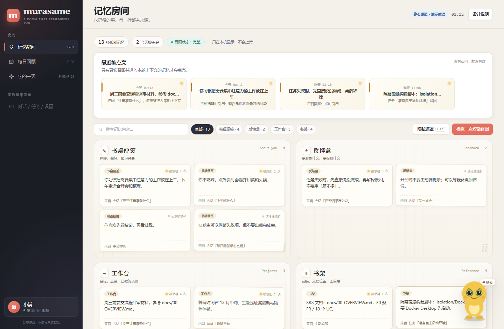
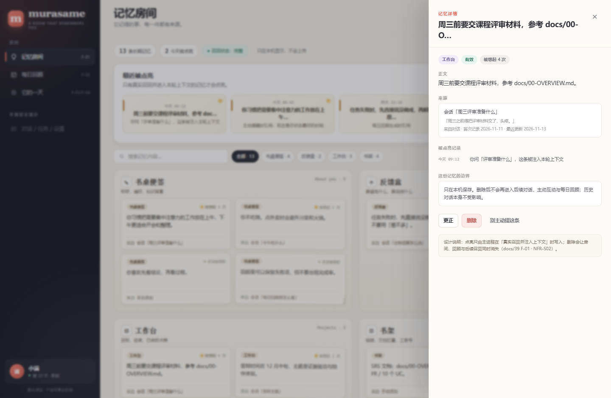
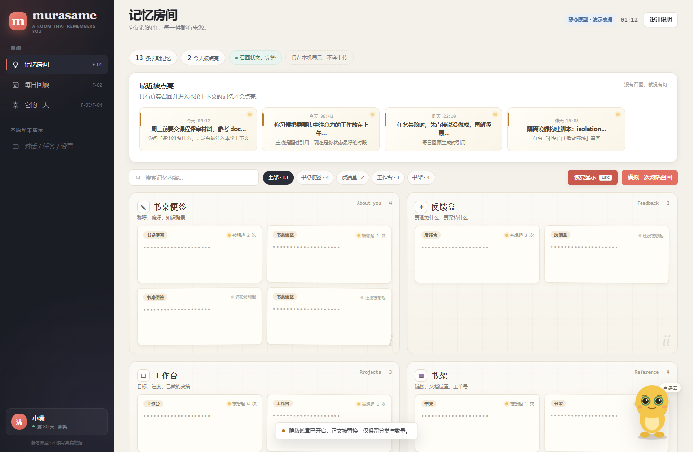
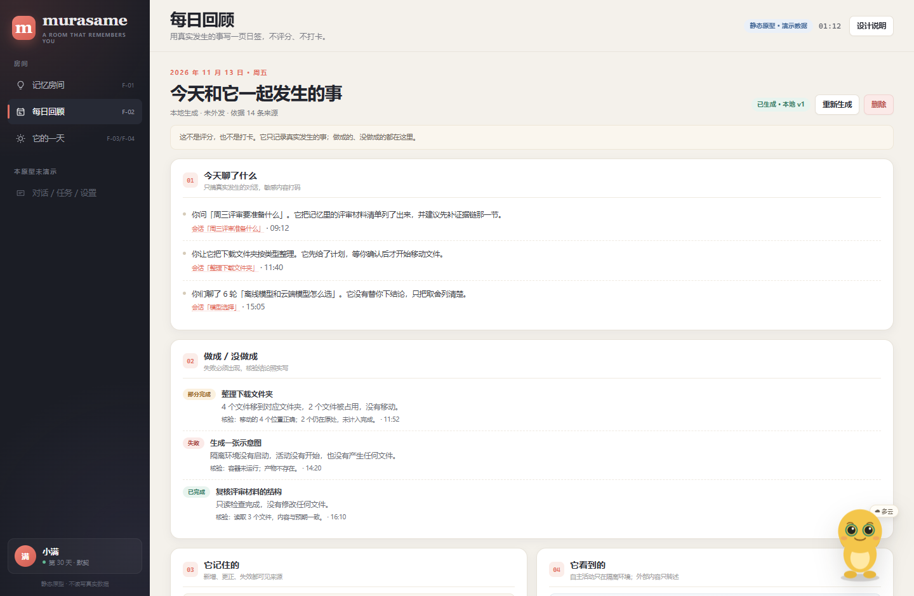
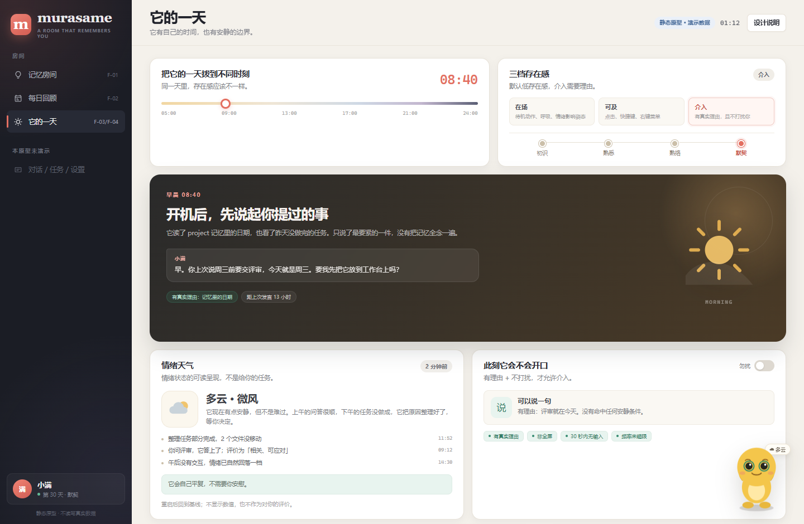
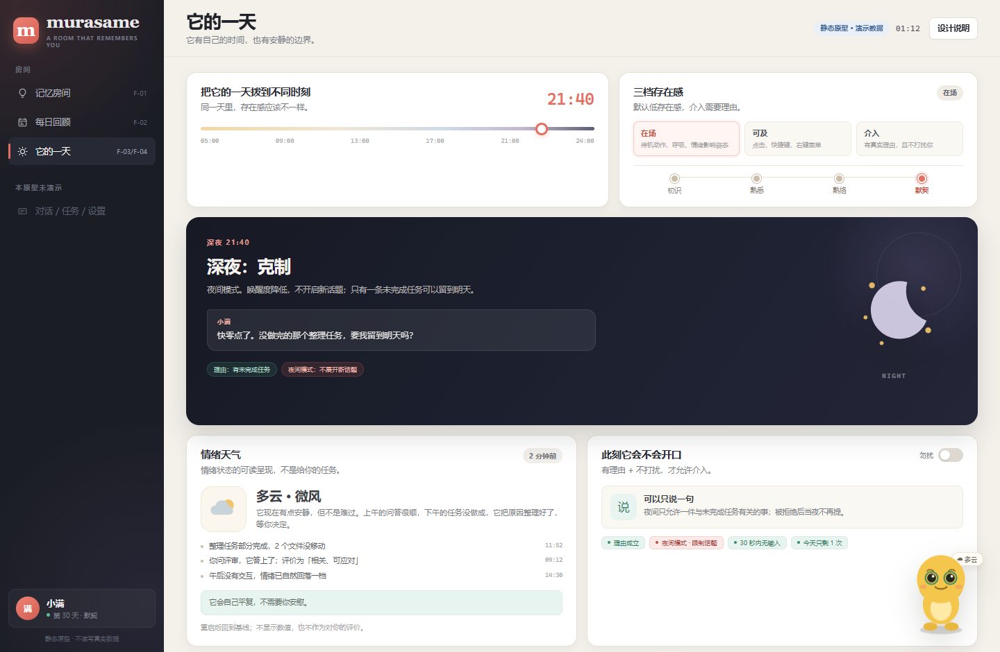
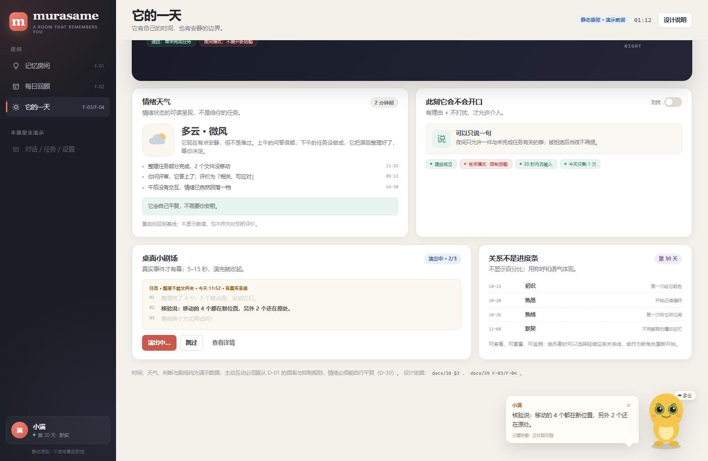
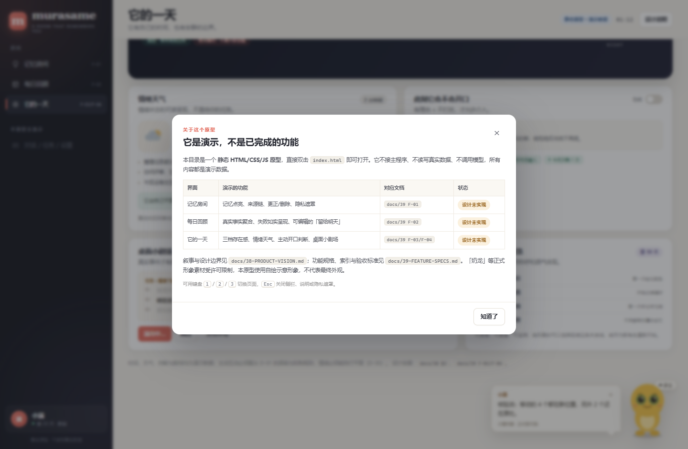

# murasame · 产品愿景静态原型

这是 [`docs/38-PRODUCT-VISION.md`](../../docs/38-PRODUCT-VISION.md) 与 [`docs/39-FEATURE-SPECS.md`](../../docs/39-FEATURE-SPECS.md) 的视觉演示：用**纯静态 HTML + CSS + JS** 做出 3 个界面，演示 4 个设计功能中的核心体验。

> **重要：这是演示原型，不是已实现的功能。**
> 它不接主程序、不读写真实数据库、不调用模型、不发网络请求。页面里的记忆、会话、任务、天气全部是虚构演示数据；刷新即恢复初始状态。
> 四个功能（F-01 记忆房间、F-02 每日回顾、F-03 情绪天气、F-04 桌面小剧场）在正式产品中均**未实现**，需要甲方确认语义后才进入任务清单。

---

## 如何打开

不需要构建、不需要安装依赖、不需要起服务器。

1. 在资源管理器里双击 `index.html`；
2. 或者在 PowerShell 里运行：

```powershell
start .\previews\vision\index.html
```

3. 建议窗口宽度 ≥ 1200px（原型按 1440×940 设计，1024px 宽也能用，侧栏不会折叠）。

快捷键：`1` 记忆房间 · `2` 每日回顾 · `3` 它的一天 · `Esc` 关闭侧栏 / 说明 / 退出隐私遮罩。

---

## 三个界面演示了什么

### 1. 记忆房间（F-01）



把长期记忆从「一列卡片」变成一间可以走进去的房间，四个区域对应 `docs/01-DECISIONS.md` D-21 的四分类：

| 区域 | 分类 | 演示内容 |
| --- | --- | --- |
| 书桌便签 | `user` | 称呼、偏好、知识背景 |
| 反馈盒 | `feedback` | 要避免什么、要保持什么 |
| 工作台 | `project` | 目标、进度、已做的决策 |
| 书架 | `reference` | 链接、文档位置、工单号 |

可以试的交互：

- 点任意记忆卡 → 右侧详情显示**来源会话、原文片段、首次记录时间、被点亮记录**；
- 点「更正」→ 改正文并保存，卡片与详情立即更新，并产生一条「更正」点亮记录；
- 点「删除」→ 两次确认后卡片消失，房间计数与回顾引用同步消失；
- 点顶部「最近被点亮」里的卡片 → 直接跳到对应记忆；
- 点「模拟一次对话召回」→ 只有被模拟注入本轮上下文的 2 条记忆会亮起；**没有被召回的不补点**；
- 点「隐私遮罩」或按 `Esc` → 正文变成圆点，只保留分类与数量（演示「他人在场时快速隐藏」）。




设计要点：点亮不是「它说它记得」，而是「这次真的用到了」；每条记忆都必须有来源；删除后不再进入对话、主动互动与回顾（NFR-S02）。

### 2. 每日回顾（F-02）



一页日签，5 段：今天聊了什么 / 做成·没做成 / 它记住的 / 它看到的 / 留给明天。

- **失败必须出现**：「生成一张示意图」失败与「整理下载文件夹」部分完成都在页面里；核验结论照实写，不写成完成；
- 页面没有任何完成率、连续天数、评分；顶部写明「这不是评分，也不是打卡」；
- 「留给明天」可直接编辑并保存，只保存在本机；
- 「这份回顾的依据」可展开，列出所有来源与「无来源被丢弃 0 条」；
- 「重新生成」会生成 v2，只重组已有事实；「删除」后显示空状态与恢复入口；
- 桌宠不朗读全文，只在傍晚说一句「今天的回顾放桌上了」。

### 3. 它的一天（F-03 + F-04）



- 拖动时间滑杆（05:00 → 24:00）：场景、存在感、主动开口判断、桌宠台词都会随之变化；
- 三档存在感：**在场 / 可及 / 介入**；默认低存在感，介入需要真实理由；
- 「此刻它会不会开口」列出判断依据（有理由、非全屏、30 秒内无输入、频率未超限、勿扰）；打开「勿扰」后立刻变成不开口；
- 情绪天气：定性描述（多云 · 微风）+ 三条真实原因 + 固定说明「它会自己平复，不需要你安慰」；不显示数值与好感度；
- 关系不是进度条：初识 → 熟悉 → 熟络 → 默契，无百分比；显示每个阶段的起始日期与「从什么时候开始这么称呼你」；
- 桌面小剧场：由真实的「整理任务部分完成」事件生成 3 句台词，点「演一幕」在桌宠气泡里逐句演出，可跳过；演过之后标记「已演 · 不重播」——失败事件绝不演成成功。




点右下角的示意桌宠可以看几句它想说的话；点「设计说明」看这个原型与真实功能状态的对照。



---

## 推荐演示顺序（约 2 分钟）

1. 打开「记忆房间」：展示四类记忆墙与「最近被点亮」，点开「周三评审材料」看来源链；
2. 点「模拟一次对话召回」：只有真实召回的卡片亮起，说明「点亮 = 真的用过」；
3. 打开「隐私遮罩」再按 `Esc`：说明隐私边界；
4. 切到「每日回顾」：指出失败任务也在回顾里，以及「没有完成率」；
5. 切到「它的一天」：把时间拨到 10:40 看「工作时段不开口」，拨到 21:40 看「深夜克制」；打开勿扰；
6. 最后点「演一幕」：小剧场只演真实事件，失败就演失败，可跳过。

---

## 文件结构

```
previews/vision/
├─ index.html          三个界面的静态结构
├─ styles.css          视觉层（设计令牌与主程序 tailwind 配置对齐）
├─ data.js             演示数据（虚构，不写回任何地方）
├─ app.js              交互层（无依赖、无模块系统，file:// 可直接运行）
├─ README.md           本文件
└─ screenshots/        真实浏览器渲染的截图（见“验证”）
```

没有构建产物、没有 node_modules、没有外部字体或图片：桌宠是内联 SVG 自绘示意形象，不引用官方角色素材（官方素材的许可限制见 `docs/05-LICENSES.md`、`docs/37-NAILONG-MESH-PET.md`）。

---

## 与真实功能的关系

| 原型界面 | 对应规格 | 上位 SRS 需求 | 状态 |
| --- | --- | --- | --- |
| 记忆房间 | `docs/39` F-01 | FR-14、FR-15、FR-12、FR-13、UC-05、NFR-S02 | 设计未实现 |
| 每日回顾 | `docs/39` F-02 | FR-12、FR-14、FR-19、FR-21、UC-04/05/06、NFR-R01 | 设计未实现 |
| 情绪天气 | `docs/39` F-03 | FR-02、D-30、NFR-U02 | 设计未实现 |
| 桌面小剧场 | `docs/39` F-04 | FR-03、FR-28~30、UC-10、D-01 | 设计未实现 |

原型**不替代**任何验收：它没有接 IPC、没有真实记忆服务、没有模型调用、没有主动互动频率控制，也没有真实桌宠窗口。它的用途是让评审者先看见体验方向，再决定要不要排期实现。

真实能力现状以 `docs/09-ISSUES.md` 为准；本文原型中出现的所有「已实现」视觉状态（如「召回状态：完整」）都是演示文案，不代表当前软件状态。

---

## 验证

- 用 Playwright + Chromium（Electron 同源内核）以 `file://` 打开，1440×940：
  - 三个界面正常渲染，**控制台 0 错误**；
  - 交互回归：模拟召回、记忆详情、更正、删除、隐私遮罩、回顾重新生成/删除/恢复、明日槽位保存、勿扰、小剧场播放/跳过、键盘导航、设计说明开合，全部通过；
  - 1024px 宽下无横向溢出。
- 截图保存在 `screenshots/`，由上述浏览器实际渲染生成，不是设计稿拼图。

已知限制：

1. 单页状态只在内存里，刷新恢复演示数据；没有持久化。
2. 桌宠为自绘 SVG 示意形象，正式版是可替换的 Live2D / 网格形象；奶龙等官方素材不得公开分发。
3. 未做完整键盘可达性与屏幕阅读器审计；配色与动效基本遵循主程序约定，但不是像素级复刻。
4. 只验证了 Chromium 系；未在 Firefox / Safari 上验证。
5. 角色名「小满」、时间、任务、记忆均为演示虚构；第 30 天设定用于展示「默契」阶段。

---

## 设计边界（请勿误读）

- 「记忆房间」目前只是一个视图；点亮事件表 `memory_light_events`、回顾表 `daily_reviews` 等数据结构是设计草案，见 `docs/39`。
- 原型里的「删除」「更正」「保存」只改内存；正式实现必须走主进程、zod 校验、`Result<T>` 返回与数据库迁移。
- 原型里的「情绪天气」是固定演示数据，没有接 `affect-service` 的 PAD，也没有接 D-30 的验证门。
- 原型里的「小剧场」是固定三句台词；正式实现的事实槽位由程序填充、模型只改句式，且必须服从 D-01 的频率与抑制规则。
- 任何把本原型当作「功能已交付」的表述都不符合 `docs/00-OVERVIEW.md` 与 `docs/09-ISSUES.md` 的诚实口径。
